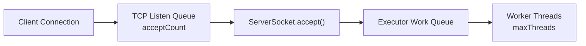

# Thread Pool and ExecutorService

### Thread Pool이란?

Thread Pool은 미리 확보하거나 필요할 때 생성한 작업 Thread를 재사용하여 여러 작업을 처리하는 방식이다.
Java의 `ExecutorService`는 작업 제출과 Thread의 생성·재사용·종료를 분리한다.
서버에서는 동시에 실행할 작업 수를 제한해 요청마다 Thread를 만드는 방식의 자원 고갈 위험을 줄일 수 있다.

### Server 적용

#### 1. Thread-per-Connection

기존 서버는 연결을 수락할 때마다 요청 처리용 Thread를 생성했다.

```java
new Thread(processor).start();
```

- 구현은 단순하지만 연결이 급증하면 Thread 수도 함께 증가한다.
- Thread 생성에는 메모리가 필요하고, Thread가 많아지면 스케줄링과 Context Switching 비용이 증가한다.

#### 2. Fixed Thread Pool

```java
private final ExecutorService executorService;

public Connector(
        final HttpHandler httpHandler,
        final int port,
        final int acceptCount,
        final int maxThreads
) throws IOException {
    this.httpHandler = httpHandler;
    this.serverSocket = new ServerSocket(port, acceptCount);
    this.executorService = Executors.newFixedThreadPool(maxThreads);
}
```

직접 Thread를 생성하는 대신 `Runnable` 작업을 `ExecutorService`에 제출한다.

```java
final var processor = new Http11Processor(connection, httpHandler);
executorService.execute(processor);
```

- `maxThreads`는 Pool이 사용할 작업 Thread 수다. 모든 Thread가 사용 중이면 추가 작업은 작업 Queue에서 대기한다.
- 값을 크게 설정한다고 처리량이 항상 증가하지 않는다. 메모리, Context Switching, CPU 수, 작업의 I/O 대기 시간과 DB Connection Pool 같은 하위 자원을 함께 고려해야 한다.

#### 3. Queue Boundaries



- `acceptCount`는 애플리케이션이 아직 `accept()`하지 않은 연결을 위한 운영체제 Listen Queue의 backlog 요청값이다.
- 운영체제가 실제 적용하는 Queue 크기와 초과 연결의 처리는 구현과 설정에 따라 달라질 수 있다.
- `accept()`된 연결에 대응하는 작업은 Executor의 Work Queue에서 별도로 대기한다.
- 따라서 `acceptCount`와 Executor Work Queue의 크기는 서로 다른 설정이다.

#### 4. Unbounded and Bounded Queue

`Executors.newFixedThreadPool()`은 내부적으로 사실상 크기 제한이 없는 `LinkedBlockingQueue`를 사용한다.
Thread 수는 제한하지만 대기 작업 수는 제한하지 않으므로, 유입 속도가 처리 속도보다 빠르면 작업과 연결이 계속 쌓일 수 있다.

실행 작업과 대기 작업을 모두 제한하려면 `ThreadPoolExecutor`에 크기가 정해진 Queue를 전달한다.

```java
new ThreadPoolExecutor(
        250,
        250,
        0L,
        TimeUnit.MILLISECONDS,
        new ArrayBlockingQueue<>(100)
);
```

- 250개 작업이 실행 중이고 100개 작업이 Queue에서 대기하면 그다음 작업은 거부된다.
- 기본 `AbortPolicy`는 거부된 작업에 `RejectedExecutionException`을 발생시킨다.
- 서버는 제출 지점에서 거부를 처리해 연결을 닫거나 가능한 경우 `503 Service Unavailable`을 응답해야 한다.
- 제한된 Queue와 거부 정책은 과부하를 없애는 것이 아니라, 과부하가 메모리 고갈로 번지기 전에 명시적으로 제어하는 장치다.

#### 5. Graceful Shutdown

Thread Pool을 생성한 `Connector`가 종료 책임도 가진다.

```java
public void stop() {
    stopped = true;

    try {
        serverSocket.close();
    } finally {
        executorService.shutdown();
    }
}
```

- `shutdown()`은 새 작업을 받지 않고 이미 실행 중이거나 Queue에서 대기 중인 작업은 계속 처리한다.
- 종료 시간을 제한하려면 `awaitTermination()`으로 기다린 뒤 필요할 때 `shutdownNow()`를 호출한다.
- `shutdownNow()`는 실행 중인 작업에 Interrupt를 요청할 뿐 즉시 종료를 보장하지 않는다. 작업도 Interrupt에 응답하도록 구현해야 한다.

#### 6. Shared State and Thread Safety

Thread Pool 적용 후에는 여러 요청이 실제로 동시에 실행되므로 공유 객체의 Thread Safety를 확인해야 한다.

```java
private static final Map<String, Session> SESSIONS =
        new ConcurrentHashMap<>();

private final Map<String, Object> values =
        new ConcurrentHashMap<>();
```

`ConcurrentHashMap`은 조회·추가·삭제 같은 개별 연산을 Thread-safe하게 수행한다. 그러나 분리된 복합 연산 전체의 Atomicity를 보장하지는 않는다.

```java
if (!map.containsKey(key)) {
    map.put(key, value);
}
```

위와 같은 검사 후 변경에는 `putIfAbsent()`나 `computeIfAbsent()`처럼 하나의 Atomic Operation으로 제공되는 API를 사용한다.
Map에 저장한 `Session` 객체 자체에 공유 가변 상태가 있다면 그 내부 상태도 별도로 보호해야 한다.

### 키워드

- [Thread](./THREAD.md), Executor, BlockingQueue, Backpressure, RejectedExecutionHandler, Graceful Shutdown, Thread Safety
