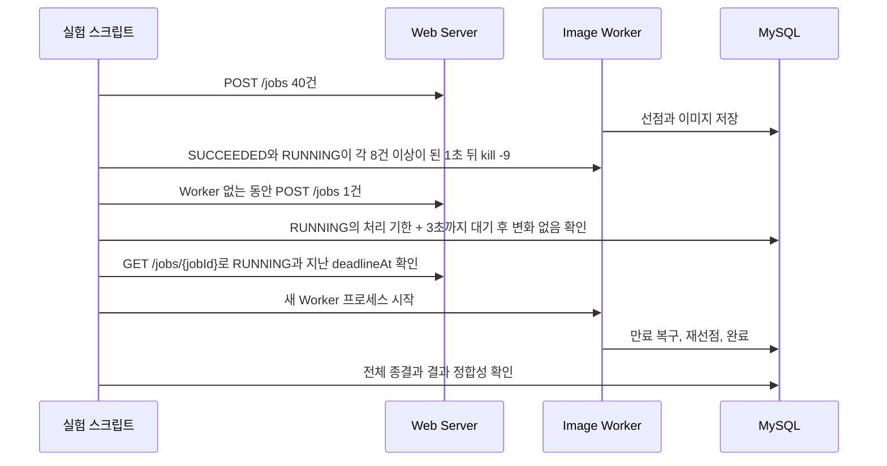

# 07. Worker 강제 종료와 재시작 복구 검증

## 결론 🧪

**채택:** 04 Job Queue 구현의 Worker 프로세스를 처리 도중 `kill -9`로 종료하고, 처리 기한이 지난 뒤 재시작해도 접수한 Job이 유실 없이 모두 완료됐다. 2026-11-09에 3회 반복했고 3회 모두 같은 결과였다.

**확인한 한계:** Worker가 하나뿐이면 만료 복구도 같은 프로세스 안에서 돌기 때문에 Worker가 없는 동안에는 복구가 일어나지 않는다. 처리 기한이 지나도 DB는 그대로였고, 재시작한 뒤에야 복구됐다.

05단계는 `RUNNING` 행을 만들고 `TestClock`으로 기한을 넘겨 복구 규칙만 검증했다. 이 단계는 그때 제외했던 실제 프로세스 종료를 별도 JVM으로 검증한다.

## 실험 절차



임시 MySQL 인스턴스를 만들어 실행하고 끝나면 삭제한다. 기존 DB는 사용하지 않는다.

## 실행 조건

| 항목 | 값 |
| --- | --- |
| 실행 일시 | 2026-11-09 21:04:29~21:07:57 (KST) |
| 환경 | Apple M3, macOS (Darwin 24.2.0 arm64), Java 21.0.5, MySQL 9.2.0, `REPEATABLE-READ` |
| 프로세스 | Web, Worker 각각 별도 JVM, `-Xms128m -Xmx512m` |
| Worker | 프로세스 1개, 동시 처리 상한 8, 모의 생성 지연 5초 |
| 선점과 복구 | 처리 기한 30초, 재시도 간격 1초, 최대 3회, Polling·복구 간격 100ms |
| 요청 | 회차당 40건 + Worker 종료 중 1건 = 41건 |
| 반복 | 3회 (회차 사이에 테이블만 비움. Web과 MySQL은 유지) |

## 실제 결과

| 지표 | 1회 | 2회 | 3회 |
| --- | ---: | ---: | ---: |
| Worker 종료 코드 | -9 | -9 | -9 |
| 종료 시 `SUCCEEDED` / `RUNNING` / `PENDING` | 8 / 8 / 24 | 8 / 8 / 24 | 8 / 8 / 24 |
| Worker 없이 지난 시간 | 32.239초 | 32.026초 | 32.092초 |
| 재시작 뒤 Worker 기동까지 | 2.046초 | 1.841초 | 1.640초 |
| 재시작 뒤 고아 `RUNNING` 복구까지 | 2.087초 | 1.863초 | 1.788초 |
| 재시작 뒤 전체 종결까지 | 27.373초 | 27.011초 | 27.031초 |
| 최종 `SUCCEEDED` / 전체 | 41 / 41 | 41 / 41 | 41 / 41 |
| `FAILED` / 누락 / 이미지 불일치 | 0 / 0 / 0 | 0 / 0 / 0 | 0 / 0 / 0 |
| `attemptCount = 2`인 Job | 8건 | 8건 | 8건 |

세 회차 모두 다음 항목을 통과했다.

- Worker가 없는 동안 앱 서버는 새 요청을 `202`로 접수했다.
- 처리 기한이 지나도 기존 Job 행은 바뀌지 않았다.
- `GET /jobs/{jobId}`는 `RUNNING`과 이미 지난 `deadlineAt`을 반환했다.
- 종료 당시 `RUNNING`이던 8건만 `attemptCount`가 2였고, 나머지는 1이었다.
- 복구된 Job에는 `processing deadline expired`가 기록됐다.

[summary.json](./results/20261109-210429/summary.json)의 값은 회차별 `at-kill.csv`, `during-outage.csv`, `final.csv`에서 다시 집계해 일치함을 확인했다.

## 범위와 한계 ⚠️

- 검증한 것은 **프로세스가 강제 종료된 경우**다. 프로세스는 살아 있고 Generator 호출만 끝나지 않는 상황은 검증하지 않았다.
- Worker는 하나이고, 재시작은 처리 기한이 지난 뒤에 했다. 여러 Worker가 있을 때 남은 Worker가 복구하는 흐름이나, 기한 전에 재시작하는 흐름은 검증하지 않았다.
- 모의 Generator를 사용했다. 실제 AI 생성 시간이나 이미 호출한 외부 생성의 중복 비용은 해석할 수 없다.
- Web과 MySQL은 종료하지 않았다.

## 재실행

```bash
cat > /tmp/print-cp.gradle <<'EOF'
allprojects {
    tasks.register('printRuntimeClasspath') {
        dependsOn 'classes'
        doLast {
            new File(System.getProperty('cpOut')).text = project.sourceSets.main.runtimeClasspath.asPath
        }
    }
}
EOF

./gradlew --offline -q -I /tmp/print-cp.gradle -DcpOut=/tmp/runtime-cp.txt printRuntimeClasspath

python3 07-worker-kill-recovery/run_kill_recovery.py \
  --classpath-file /tmp/runtime-cp.txt \
  --java "$JAVA_HOME/bin/java" \
  --work-dir /tmp/kill-recovery
```

Java 21과 `mysqld`, `mysql` CLI가 필요하다. 결과는 `07-worker-kill-recovery/results/{실행 시각}/`에 저장된다.
