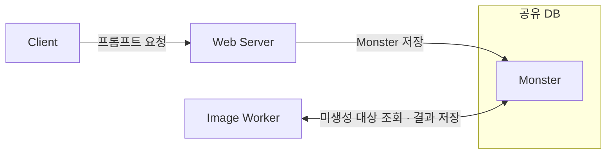
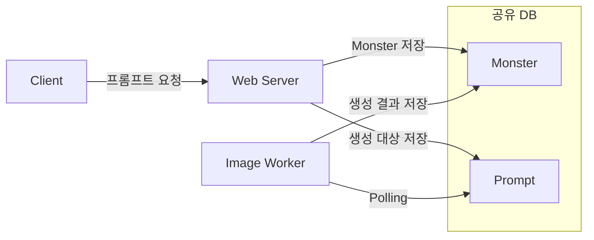

# ① 이미지 생성 요청 약 300건 처리 중 장애와 신뢰성 검증 범위

이번 글에서는 HTTP 요청을 접수한 뒤에도 이미지 생성 작업을 보존하고, 완료·실패 여부를 추적하는 백엔드 처리 규칙을 검증합니다. 커켓몬을 운영하면서 겪은 장애를 계기로, 웹 서버와 이미지 생성 서버가 DB를 통해 협력하는 과정을 다시 살펴봤습니다.

## 초기 구조: 이미지가 없는 `Monster`의 Polling 조회

커켓몬은 사용자가 입력한 프롬프트로 자신만의 몬스터 이미지를 만드는 서비스였습니다. 초기에는 웹 서버가 프롬프트를 가진 `Monster`를 DB에 저장했습니다. 별도의 이미지 생성 서버(이하 Worker)는 이미지가 없는 `Monster`를 일정한 간격으로 조회하고, 모델을 호출해 생성한 이미지를 같은 DB에 기록했습니다. 이처럼 DB를 주기적으로 조회하는 방식을 Polling이라고 합니다.

| 테이블 | 역할 | Worker의 사용 방식 |
| --- | --- | --- |
| `Monster` | 프롬프트와 생성 결과를 보관합니다. | 이미지가 없는 `Monster`를 찾아 생성 결과를 기록합니다. |

2025년 행사에서 35명의 사용자로부터 약 300건의 이미지 생성 요청이 들어왔습니다. 이를 처리하던 중 시스템이 사용자 요청에 응답하지 못하는 장애가 발생했습니다.

## 당시 대응: `Prompt` 분리와 디바운스·계정당 하루 10개 생성 제한

장애 이후에는 Worker가 이미지 생성 대상을 조회하는 테이블을 `Monster`에서 `Prompt`로 바꿨습니다. 프론트에서 연속 요청을 줄이는 디바운스와 계정당 하루 10개 생성 제한도 함께 적용했습니다. 최종 발표에서는 이전과 비슷한 규모의 요청을 처리할 수 있었습니다.

| 테이블 | 역할 | Worker의 사용 방식 |
| --- | --- | --- |
| `Monster` | 몬스터 도메인 데이터와 생성 결과를 보관합니다. | 생성 결과를 기록합니다. |
| `Prompt` | 이미지 생성 대상을 따로 보관합니다. | 생성 대상을 Polling으로 조회합니다. |

위 표와 그림은 과거 기록을 바탕으로 각 테이블의 역할과 데이터 흐름을 요약한 개념도입니다. 당시 테이블의 상세 컬럼과 `Prompt`·`Monster`의 연결 방식은 확인이 필요합니다.

## 기록의 한계: 변경별 효과와 작업별 처리 결과 미측정

당시에는 이 대응이 서비스 안정화에 도움이 됐다고 판단했습니다. 다만 여러 변경을 함께 적용했으므로 각각의 효과를 구분할 수 없었습니다. 작업별 접수·완료·실패 여부를 측정한 기록도 없었습니다. 작업 유실·중복 실행 여부와 시스템이 요청에 응답하지 못한 원인은 확인이 필요합니다. 따라서 비슷한 규모를 다시 처리한 사실만으로 개별 작업이 모두 올바르게 처리됐다고 판단할 수는 없습니다.

## 현재 실험: DB를 공유하는 웹 서버·Worker의 신뢰성 문제 5가지 검증

살펴볼 대상은 웹 서버의 요청 등록부터 Worker의 작업 실행과 결과 반영까지입니다. 프론트 디바운스와 계정당 하루 10개 생성 제한은 당시 대응의 배경으로 소개하며, 프론트 구현과 생성 정책의 설계·검증은 글의 범위에서 제외합니다.

실험에서는 과거 구조를 참고해 Java, Spring Boot, JPA로 새로 만든 ‘최소 구조’를 기준으로 삼습니다. 웹 서버와 Worker는 각각 별도 JVM 프로세스로 실행하도록 구성하고 MySQL만 공유합니다. 이미지 생성은 지연을 주는 모의 생성기(Generator)로 대체합니다.

이 글에서는 이미지 생성 작업 한 건을 Job이라고 합니다. 선점은 Worker가 Job을 처리할 권한을 얻는 과정입니다. 이번 실험에서는 요청 등록부터 결과 반영까지 발생할 수 있는 다음 다섯 가지 신뢰성 문제를 검증합니다.

1. **등록 비원자성:** `Monster` 저장 후 Job 등록이 실패하면 생성 작업이 없는 `Monster`가 남을 수 있습니다.
2. **중복 선점:** 여러 Worker가 같은 Job을 조회하고 모두 실행하면 이미지 생성이 중복될 수 있습니다.
3. **작업 유실:** 처리 전에 작업 행을 삭제하고 Worker가 멈추면, 복구할 작업 행이 DB에 남지 않습니다.
4. **결과 오연결:** Job ID를 `Monster` ID처럼 사용하면 생성 결과가 다른 `Monster`에 저장될 수 있습니다.
5. **Scheduler 중단:** 한 작업의 예외로 주기적인 작업 조회가 중단되면 이후 Job도 처리되지 않을 수 있습니다.

이 다섯 문제는 현재 재구성 코드에서 검증할 잠재적 신뢰성 문제이며, 과거 장애에서 실제로 발생했는지는 확인이 필요합니다. 최소 구조에서 각 실패를 재현한 뒤, 신뢰성 규칙을 추가한 현재 실험의 ‘개선 구조’에서 같은 조건을 검증합니다. 개선 구조에 추가하는 규칙은 작업 상태, 원자적 선점, 타임아웃 복구, 재시도, 오래된 결과 거부입니다.

---

근거: [과거 운영 기록과 확인하지 못한 내용](../01-past-structure-and-limitations/README.md), [최소 DB Polling 구조](../02-minimal-db-polling/README.md), [다섯 가지 잠재적 실패](../03-failure-reproduction/README.md).

다음: [② 비교한 방법](./02-options.md).
