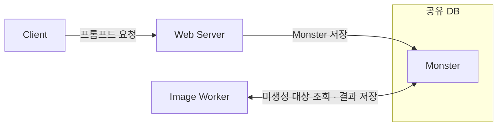
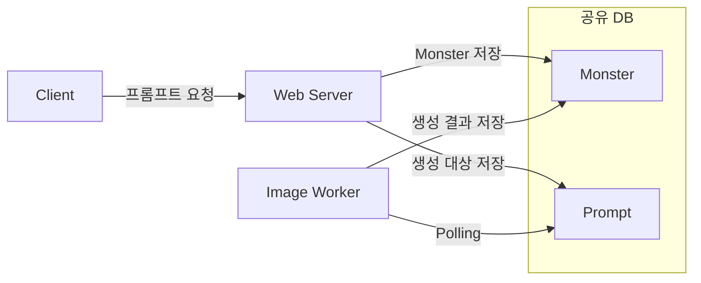

# ① 문제: 어떤 문제가 있었나요?

이미지 생성 작업을 별도 서버에 맡겼다면, 요청이 생성 결과로 이어지는 과정도 추적할 수 있어야 합니다. 커켓몬을 운영하면서 겪은 장애는 그 과정을 다시 살펴보는 계기가 됐습니다.

## 과거 초기 구조: Monster에서 생성 대상을 조회했습니다

커켓몬은 사용자가 입력한 프롬프트로 자신만의 몬스터 이미지를 만드는 서비스였습니다. 초기에는 웹 서버가 프롬프트를 가진 Monster를 DB에 저장하고, 별도의 이미지 생성 서버가 이미지가 없는 Monster를 주기적으로 조회했습니다. 이미지 생성 서버는 모델을 호출한 뒤 결과를 같은 DB에 기록했습니다. DB를 주기적으로 읽는 Polling 방식으로 두 서버가 협력하는 구조였습니다.

| 테이블 | 역할 | Worker의 조회 대상 |
| --- | --- | --- |
| `Monster` | 프롬프트와 생성 결과를 가진 도메인 데이터입니다. | 이미지가 없는 Monster를 찾습니다. |

2025년 행사에서 35명의 사용자로부터 약 300건의 이미지 생성 요청이 들어왔습니다. 이를 처리하던 중 시스템이 사용자 요청에 응답하지 못하는 장애가 발생했습니다.

## 당시 개선 구조: Prompt로 생성 대상을 분리했습니다

이후 이미지 생성 대상을 별도의 `Prompt` 테이블에 저장하도록 바꾸고, 프론트 디바운스와 계정당 하루 10개 생성 제한을 함께 적용했습니다. `Prompt` 테이블 분리는 조회할 대상을 줄이기 위한 선택이었고, 디바운스와 생성 제한은 요청 유입을 줄이기 위한 대응이었습니다. 최종 발표에서는 이전과 비슷한 규모의 요청을 처리할 수 있었습니다.

| 테이블 | 역할 | Worker의 사용 방식 |
| --- | --- | --- |
| `Monster` | 몬스터 도메인 데이터와 생성 결과를 보관합니다. | 생성 결과를 기록합니다. |
| `Prompt` | 이미지 생성 대상을 따로 보관합니다. | 생성 대상을 Polling으로 조회합니다. |

두 구조의 차이는 Worker가 조회하는 생성 대상을 `Monster`에서 `Prompt`로 옮겼다는 점입니다. 위 표와 그림은 과거 기록의 역할을 요약한 개념도입니다. 당시 테이블의 상세 컬럼과 `Prompt`·`Monster`의 연결 방식은 과거 DDL 확인이 필요합니다. 현재 실험에서 추가하는 Job 상태와 claimToken은 이 당시 개선 구조와 구분합니다.

## 이번 글에서 검증할 백엔드 작업 처리

당시에는 이 대응이 서비스 안정화에 도움이 됐다고 판단했습니다. 다만 여러 변경을 함께 적용했으므로 각각의 효과는 알 수 없었습니다. 요청이 몇 건 접수됐고, 몇 건이 완료되거나 실패했는지 작업 단위로 측정한 기록도 없었습니다. 작업이 유실되거나 중복 실행됐는지, 요청 미응답 장애의 원인이 무엇이었는지는 확인이 필요합니다. 비슷한 규모를 다시 처리했다는 사실만으로 개별 작업의 신뢰성까지 검증됐다고 판단하기는 어렵습니다.

이번 글에서는 웹 서버가 접수한 작업을 백엔드에서 보존하고 처리하는 과정에 집중합니다. 프론트 디바운스와 계정당 하루 10개 생성 제한은 당시 대응의 배경으로 소개하며, 프론트 구현과 생성 정책의 설계·검증은 글의 범위에서 제외합니다. 살펴볼 대상은 요청 등록, 동시 선점, 결과 반영, 타임아웃 복구와 재시도입니다.

이 경험을 바탕으로 현재는 과거와 유사한 구조를 Java와 Spring Boot, JPA로 재구성하고 있습니다. 웹 서버와 이미지 워커를 별도 JVM으로 실행하고 MySQL만 공유합니다. 과거 코드 자체를 복원하는 실험은 아니며, 이미지 생성도 모의 Generator로 대체합니다. 이 재구성에서는 요청 등록부터 결과 반영까지 다음 다섯 경계에 주목합니다.

1. **등록 비원자성:** Monster 저장 후 Job 등록이 실패하면, 생성 작업이 없는 Monster가 남을 수 있습니다.
2. **중복 선점:** 여러 Worker가 같은 작업을 조회하고 모두 실행하면 이미지 생성이 중복될 수 있습니다.
3. **작업 유실:** 처리 전에 작업 행을 삭제하고 Worker가 멈추면, 복구할 작업 행이 DB에 남지 않습니다.
4. **결과 오연결:** 작업 ID를 Monster ID처럼 사용하면 생성 결과가 다른 Monster에 저장될 수 있습니다.
5. **Scheduler 중단:** 한 작업의 예외가 반복 실행을 멈추면 이후의 작업도 처리되지 않을 수 있습니다.

이 다섯 가지는 현재 재구성 코드에서 검증할 잠재적 신뢰성 문제입니다. 과거 장애의 원인으로 확인된 사실과는 구분해야 합니다. 이번 글에서는 최소 구조에서 각 실패를 재현하고, 작업 상태와 원자적 선점, 타임아웃 복구, 재시도, 오래된 결과 거부가 어떤 조건을 보장하는지 확인합니다. 목표는 HTTP 요청을 접수한 뒤에도 작업을 보존하고, 완료되거나 실패한 결과를 추적할 수 있는 처리 규칙을 만드는 것입니다.

---

근거: [과거 운영 기록과 확인하지 못한 내용](../01-past-structure-and-limitations/README.md), [최소 DB Polling 구조](../02-minimal-db-polling/README.md), [다섯 가지 잠재적 실패](../03-failure-reproduction/README.md).

다음: [② 비교한 방법](./02-options.md).
