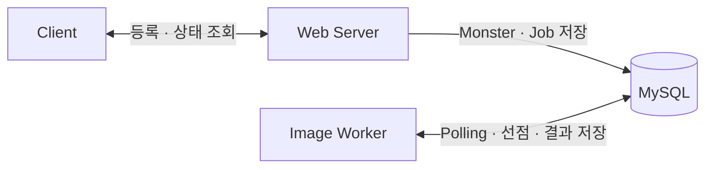
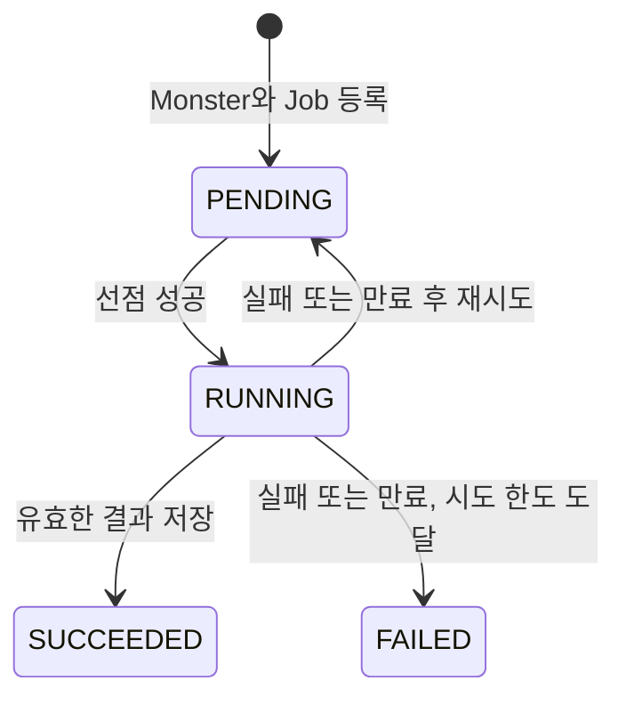
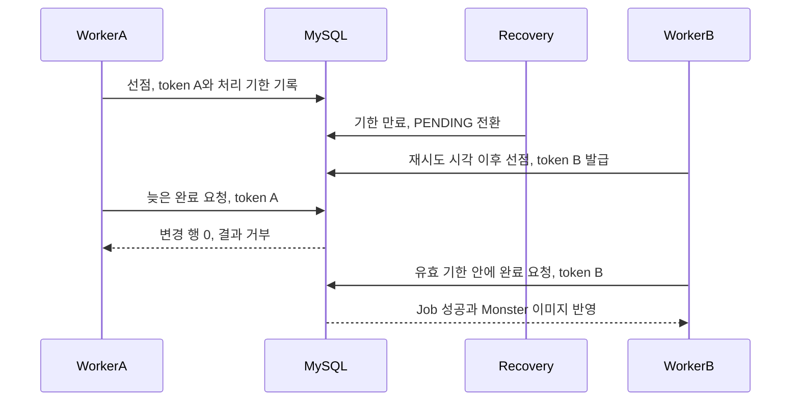

# ③ DB Job Queue의 등록·선점·복구·결과 반영 규칙 구현

②에서 선택한 DB Job Queue에 등록 트랜잭션, 작업 상태, 원자적 선점, 타임아웃 복구와 결과 반영 규칙을 추가했습니다. 웹 서버와 Worker가 MySQL만 공유하는 구조는 유지하고, 요청 등록부터 결과 저장까지 각 작업을 추적할 수 있도록 했습니다.

이번 구현은 ①에서 설명한 과거 구조를 참고해 재구성한 최소 구조를 기준으로 삼았습니다. 최소 구조에서 어떤 문제가 생길 수 있었는지와, 이를 다루기 위해 추가한 규칙을 차례로 설명하겠습니다.

## 별도 JVM으로 나눈 웹 서버와 Worker

웹 서버와 Worker를 각각 별도의 JVM으로 실행하도록 애플리케이션을 나눴습니다. 웹 서버는 요청 등록과 상태 조회를 맡고, Worker는 DB에서 작업을 찾아 이미지를 생성하고 결과를 기록하도록 했습니다.

웹 서버는 `POST /jobs`로 받은 프롬프트를 `Monster`와 Job으로 저장합니다. 등록 트랜잭션이 커밋되면 `202 Accepted`와 두 식별자를 반환합니다. 이 응답은 작업 접수가 완료됐다는 의미이며, 이후 상태와 생성 결과는 `GET /jobs/{jobId}`로 조회합니다.

Worker는 HTTP 서버를 열지 않고 MySQL에서 실행할 Job을 Polling으로 조회합니다. 이미지 생성에는 일정 시간 뒤 `image:{prompt}`를 반환하는 모의 생성기(Generator)를 사용했습니다. 생성 지연을 제어하면서 작업 처리 규칙을 살펴보기 위한 구성입니다.



`Monster`에는 몬스터 정보와 생성 결과를, Job에는 작업 상태와 실행 정보를 보관했습니다.

| 테이블 | 역할 | 핵심 데이터 |
| --- | --- | --- |
| `queue_monster` | 몬스터 정보와 생성 결과 보관 | `monster_id`, `prompt`, `image` |
| `image_generation_job` | 생성 작업의 상태와 실행 권한 관리 | `job_id`, `monster_id`, `status`, `attempt_count`, `next_attempt_at`, `deadline_at`, `claim_token` |

표와 그림은 이번 재구성의 테이블과 처리 흐름을 요약한 것입니다. 전체 컬럼과 제약 조건은 [개선 구조의 스키마](../04-reliability-hardening/src/main/resources/db/04/schema.sql)를 참조합니다.

## Monster와 Job을 함께 저장하는 등록 트랜잭션

최소 구조에서는 `Monster` 저장과 생성 요청 저장을 하나의 트랜잭션으로 묶지 않았습니다. `Monster`를 저장한 뒤 생성 요청 저장에 실패하면, 생성할 작업이 없는 `Monster`가 남을 수 있었습니다.

개선 구조에서는 [JobRegistrationService.request()](../04-reliability-hardening/src/main/java/com/kng0501/dbqueue/server/application/JobRegistrationService.java)에 트랜잭션 경계를 두고 두 데이터를 함께 저장했습니다. Job 저장이 실패하면 앞서 저장한 `Monster`도 함께 롤백되도록 했습니다.

등록할 때는 Job이 결과 대상인 `Monster`를 명시적으로 참조하도록 했습니다. 이후 결과를 저장할 때도 이 연결에 기록된 `monster_id`를 사용합니다.

## 작업 행을 보존하는 네 가지 상태

[최소 Worker](../02-minimal-db-polling/src/main/java/com/kng0501/dbpolling/worker/application/DbPollingWorker.java)는 조회한 요청 행을 삭제한 뒤 Generator를 호출합니다. 삭제 이후 생성 중에 예외가 발생하면 다시 처리할 요청 행을 찾을 수 없습니다.

개선 구조에서는 Job 행을 보존하고 상태로 처리 과정을 나타냈습니다. `PENDING`은 대기 중인 작업, `RUNNING`은 Worker가 선점한 작업입니다. 결과 저장에 성공하면 `SUCCEEDED`, 실패나 기한 만료 후 더 시도할 수 없으면 `FAILED`로 종결합니다.



성공하거나 최종 실패한 Job도 남겨둡니다. 이를 통해 작업의 최종 상태와 시도 횟수, 실패 사유를 조회할 수 있도록 했습니다.

## 조건부 UPDATE로 실행 권한 획득

여러 Worker가 같은 대기 작업을 조회하는 것은 가능합니다. 그래서 후보 조회와 선점을 나누고, 해당 Job을 `PENDING`에서 `RUNNING`으로 바꾸는 데 성공한 Worker만 Generator를 호출하도록 했습니다.

아래는 [선점 쿼리](../04-reliability-hardening/src/main/java/com/kng0501/dbqueue/worker/persistence/jpa/ImageGenerationJobJpaRepository.java)에 사용한 JPQL입니다.

```sql
update ImageGenerationJobEntity job
   set job.status = :running,
       job.claimToken = :token,
       job.deadlineAt = :deadline,
       job.attemptCount = job.attemptCount + 1,
       job.startedAt = :now,
       job.finishedAt = null
 where job.id = :jobId
   and job.status = :pending
   and job.nextAttemptAt <= :now
   and job.attemptCount < :maxAttempts
```

대기 상태이면서 다음 실행 가능 시각이 됐고, 최대 시도 횟수에 도달하지 않은 Job만 선점할 수 있습니다. UPDATE가 변경한 행이 1개이면 실행 권한을 얻고, 0개이면 실행하지 않습니다.

선점할 때마다 새로운 실행 식별자인 `claimToken`과 처리 기한인 `deadlineAt`을 함께 기록합니다. 시도 횟수도 이때 증가합니다. 이후 완료·실패 요청이 어느 실행에서 왔는지 구분하기 위한 정보입니다.

조건부 UPDATE에도 InnoDB의 레코드 잠금이 사용됩니다. 선점 트랜잭션은 이미지 생성 전에 커밋하고, Generator 호출은 트랜잭션 밖에서 실행하도록 했습니다. 이미지 생성 시간 동안 선점 트랜잭션과 잠금을 유지하지 않도록 하기 위해서입니다. [MySQL의 UPDATE 잠금 설명](https://dev.mysql.com/doc/refman/8.4/en/innodb-locks-set.html)

JPA의 일괄 UPDATE 뒤에 이전 엔티티 상태를 재사용하지 않도록 `@Modifying`에 `flushAutomatically = true`, `clearAutomatically = true`를 설정했습니다. 선점 후에는 Job 데이터를 다시 조회해 실행에 사용할 스냅샷으로 변환합니다. [Spring Data JPA의 변경 쿼리 설명](https://docs.spring.io/spring-data/jpa/reference/jpa/query-methods.html#jpa.modifying-queries)

## 처리 기한 만료 후 복구와 재시도

Worker가 선점한 뒤 완료나 실패를 기록하지 못하면 Job은 `RUNNING`에 남습니다. 이 상태를 다시 처리할 수 있도록 별도의 복구 작업이 처리 기한이 지난 Job을 주기적으로 조회하게 했습니다.

재시도 여유가 있으면 Job을 `PENDING`으로 돌리고, 재시도 간격을 더한 다음 실행 가능 시각을 `nextAttemptAt`에 기록합니다. 최대 시도 횟수를 채운 상태에서 실패하거나 기한이 만료되면 `FAILED`로 종결합니다.

복구 대상을 조회한 뒤에도 다른 처리가 진행될 수 있습니다. 그래서 [복구 전환](../04-reliability-hardening/src/main/java/com/kng0501/dbqueue/worker/application/ExpiredJobTransition.java)의 UPDATE에서도 상태, 현재 token, 시도 횟수와 기한 만료 조건을 다시 확인합니다. 조회 당시의 정보로 이미 완료됐거나 재선점된 작업을 바꾸지 않도록 했습니다.

## claimToken으로 오래된 결과 거부

기한이 만료된 Job을 다시 선점하면 새로운 `claimToken`을 발급합니다. 이때 이전 Worker의 이미지 생성이 늦게 끝나더라도, 이전 token으로 현재 작업의 결과를 바꿀 수 없어야 합니다.



완료 UPDATE는 `RUNNING` 상태, 현재 `claimToken`, `deadlineAt > now` 조건을 함께 검사합니다. 변경한 행이 0개이면 `Monster`의 이미지도 갱신하지 않습니다. 실패 전환에도 현재 token과 시도 횟수, 유효 기한 조건을 적용했습니다.

완료 처리에서는 Job의 성공 전환과 `Monster`의 이미지 갱신을 [하나의 트랜잭션](../04-reliability-hardening/src/main/java/com/kng0501/dbqueue/worker/application/JobQueue.java)으로 묶었습니다. 결과 대상은 Job의 `monster_id`로 찾고, 이미지 갱신이 실패하면 성공 전환도 함께 롤백합니다.

**오래된 결과를 거부하는 범위는 DB 결과 반영입니다.** 처리 기한이 지났다고 기존 Generator 호출이 자동으로 중단되지는 않습니다. 이전 실행과 재시도가 겹치면 이미지 생성 호출 자체는 중복될 수 있습니다.

## Job 실패 처리와 주기적 조회의 예외 처리

[JobWorker](../04-reliability-hardening/src/main/java/com/kng0501/dbqueue/worker/application/JobWorker.java)는 이미지 생성이나 완료 처리에서 예외가 발생하면 해당 Job의 실패 전환을 시도합니다. 실패 기록마저 저장하지 못하면 오류를 로그에 남기고, DB에 보존된 `RUNNING` 상태와 처리 기한을 통해 만료 복구가 다시 접근하도록 했습니다.

[JobPollingTasks](../04-reliability-hardening/src/main/java/com/kng0501/dbqueue/worker/application/JobPollingTasks.java)에서는 작업 조회와 만료 복구를 실행하는 스케줄러 경계에서 `RuntimeException`을 기록하도록 했습니다. 한 번의 조회나 복구에서 발생한 예외를 처리하고 다음 주기에도 실행할 수 있도록 구성했습니다.

이미지 생성용 실행 풀과 조회·복구용 스케줄러도 분리했습니다. 긴 이미지 생성이 제어용 스케줄러의 스레드를 점유하지 않도록 하고, [JobScheduler](../04-reliability-hardening/src/main/java/com/kng0501/dbqueue/worker/application/JobScheduler.java)가 실행 여유를 확보한 뒤 Job을 선점하도록 했습니다.

다음 [④ 달라진 점과 근거](./04-results.md)에서는 같은 다섯 가지 조건으로 최소 구조의 실패 재현과 개선 구조의 회귀 검증 결과를 비교하겠습니다. 테스트로 확인한 범위와 실제 JVM 종료·재시작 검증이 필요한 범위도 함께 정리하겠습니다.
