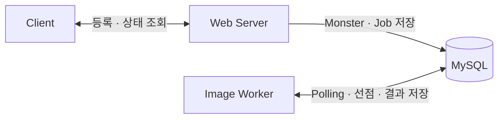
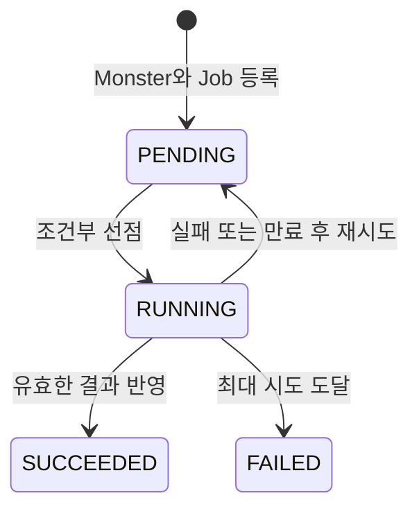
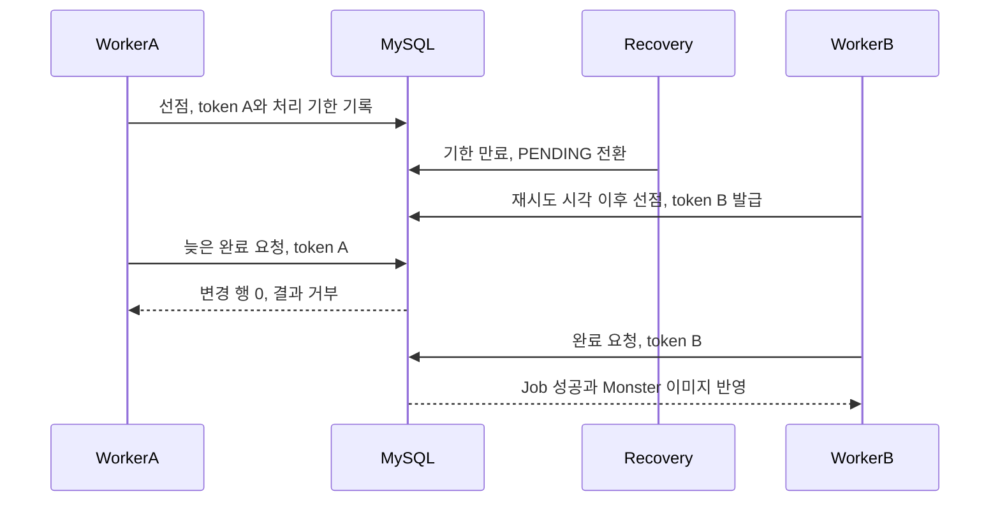

# ③ 해 본 일: 무엇을 해 봤나요?

①에서 설명한 당시 `Prompt` 분리 구조를 출발점으로, 현재는 작업 처리 규칙을 검증할 수 있는 최소 구조를 재구성했습니다. 웹 서버와 Worker를 별도 JVM으로 실행하도록 애플리케이션을 나누고, 두 프로세스는 MySQL만 공유하도록 했습니다. 여기에 상태, 선점, 복구와 결과 반영 규칙을 추가했습니다.

## 두 프로세스의 역할을 DB로 연결했습니다

웹 서버는 `POST /jobs`로 받은 프롬프트를 Monster와 Job으로 저장합니다. 등록 트랜잭션이 커밋되면 `202 Accepted`와 두 식별자를 반환합니다. 이 응답은 이미지 생성 완료가 아닌 작업 접수를 나타내며, 결과는 `GET /jobs/{jobId}`로 조회합니다.

Worker는 HTTP 서버를 열지 않습니다. DB에서 실행할 Job을 찾아 이미지를 생성하고 상태와 결과를 기록합니다. 실제 AI 모델 대신 지연 후 `image:{prompt}`를 반환하는 모의 Generator를 사용해 작업 처리 규칙에 집중했습니다.



| 테이블 | 역할 | 핵심 데이터 |
| --- | --- | --- |
| `queue_monster` | 몬스터 도메인 데이터와 생성 결과를 보관합니다. | `monster_id`, `prompt`, `image` |
| `image_generation_job` | 생성 요청의 상태와 실행 권한을 관리합니다. | `job_id`, `monster_id`, `status`, `attempt_count`, `next_attempt_at`, `deadline_at`, `claim_token` |

이 표는 현재 실험의 실제 스키마를 요약한 것입니다. 과거 `Prompt` 테이블의 DDL을 복원한 것은 아닙니다. 전체 컬럼과 제약 조건은 [04 스키마](../04-reliability-hardening/src/main/resources/db/04/schema.sql)를 참조합니다.

## Monster와 Job을 함께 등록했습니다

최소 구조에서는 Monster 저장과 생성 요청 저장을 하나의 트랜잭션으로 묶지 않았습니다. 두 번째 저장이 실패하면 Monster만 남을 수 있었습니다. 개선 구조에서는 `JobRegistrationService.request()`에 트랜잭션 경계를 두고 두 데이터를 함께 저장했습니다.

Job은 등록할 때 결과 대상인 Monster를 명시적으로 참조합니다. 작업 ID와 Monster ID가 우연히 같을 것으로 기대하지 않고, Job의 `monster_id`를 결과 반영에 사용합니다. 완료 처리에서는 Job의 성공 전환과 Monster 이미지 갱신도 한 트랜잭션으로 묶었습니다. 이미지 갱신이 실패하면 성공 전환도 롤백되도록 했습니다.

## 처리 중인 작업을 삭제하지 않고 상태로 남겼습니다

최소 Worker는 조회한 요청을 삭제한 뒤 Generator를 호출합니다. 이후 예외가 발생하면 Worker가 다시 찾을 작업 행이 남지 않습니다. 개선 구조는 Job을 보존하고 다음 네 상태로 처리 과정을 나타냅니다.



`RUNNING`에는 현재 선점의 처리 기한과 claimToken이 남습니다. `SUCCEEDED`와 `FAILED`도 삭제하지 않아 상태를 조회하고 검증할 수 있습니다. 실패·만료 후 재시도 여유가 있으면 `PENDING`으로 돌아가고, 다음 실행 가능 시각을 기록합니다. 최대 시도에 도달하면 `FAILED`로 종결합니다.

## 후보 조회와 실행 권한 획득을 분리했습니다

두 Worker가 같은 후보를 읽는 것은 가능합니다. 중요한 조건은 그중 하나만 실행 권한을 얻는 것입니다. 후보 ID를 조회한 뒤 다음 조건부 UPDATE가 1행을 변경한 Worker만 Generator를 호출하도록 했습니다. 아래 코드는 실제 선점 JPQL입니다.

```sql
update ImageGenerationJobEntity job
   set job.status = :running,
       job.claimToken = :token,
       job.deadlineAt = :deadline,
       job.attemptCount = job.attemptCount + 1,
       job.startedAt = :now,
       job.finishedAt = null
 where job.id = :jobId
   and job.status = :pending
   and job.nextAttemptAt <= :now
   and job.attemptCount < :maxAttempts
```

후보를 먼저 읽었다는 사실만으로 소유권을 인정하지 않습니다. 조건부 UPDATE가 0행이면 실행하지 않습니다. 선점이 성공하면 새 claimToken을 발급하고 시도 횟수를 증가시킵니다. 벌크 UPDATE 뒤에는 영속성 컨텍스트를 정리하고 불변 Job 데이터를 다시 읽습니다.

선점 트랜잭션은 이미지 생성 전에 커밋합니다. 생성하는 동안 DB 트랜잭션과 행 잠금을 유지하지 않고, 완료나 실패를 별도 트랜잭션에서 기록합니다.

## 기한이 지난 실행의 결과를 거부했습니다

Worker가 선점한 뒤 완료·실패를 기록하지 못하면 Job은 `RUNNING`에 남습니다. 복구 작업은 처리 기한이 지난 Job을 찾아 재시도하거나 종결합니다. 재선점할 때는 이전 실행과 다른 claimToken을 발급합니다.



완료 UPDATE는 `RUNNING` 상태, 현재 claimToken, 유효한 처리 기한을 함께 확인합니다. A의 생성이 늦게 끝나더라도 B가 재선점한 뒤에는 A의 결과를 반영하지 않습니다. 실패와 만료 복구에도 상태·token·시도 횟수 조건을 적용해 오래된 실행이 현재 상태를 바꾸지 못하도록 했습니다.

**보장 범위는 같은 Job의 최종 DB 결과 반영입니다.** 기한 만료가 이전 Generator 실행을 자동으로 중단하지는 않으며, 이미지 생성 호출 자체는 중복될 수 있습니다.

## 한 작업의 실패를 기록하고 다음 반복을 유지하도록 구성했습니다

`JobWorker`는 생성이나 완료 처리에서 발생한 예외를 Job 실패 전환으로 연결합니다. 실패 기록도 저장하지 못하면 `RUNNING` 행과 기한을 남겨 만료 복구가 다시 접근할 수 있도록 합니다. Polling과 복구의 Scheduler 경계에서도 예외를 기록하도록 구성했습니다.

이미지 실행 풀과 제어용 Scheduler는 분리하고, 실행 여유를 확보한 뒤 Job을 선점합니다. 이렇게 구성해 긴 이미지 생성이 복구 작업의 실행 스레드를 점유하지 않도록 했습니다. 한 작업의 실패 후 특정 후속 Job이 실제로 완료되는지는 다음 장의 회귀 테스트에서 확인합니다.

---

근거: [최소 Worker](../02-minimal-db-polling/src/main/java/com/kng0501/dbpolling/worker/application/DbPollingWorker.java), [등록 트랜잭션](../04-reliability-hardening/src/main/java/com/kng0501/dbqueue/server/application/JobRegistrationService.java), [선점·완료 쿼리](../04-reliability-hardening/src/main/java/com/kng0501/dbqueue/worker/persistence/jpa/ImageGenerationJobJpaRepository.java), [결과 반영 트랜잭션](../04-reliability-hardening/src/main/java/com/kng0501/dbqueue/worker/application/JobQueue.java), [Scheduler 구현](../04-reliability-hardening/src/main/java/com/kng0501/dbqueue/worker/application/JobScheduler.java).

다음: [④ 달라진 점과 근거](./04-results.md).
