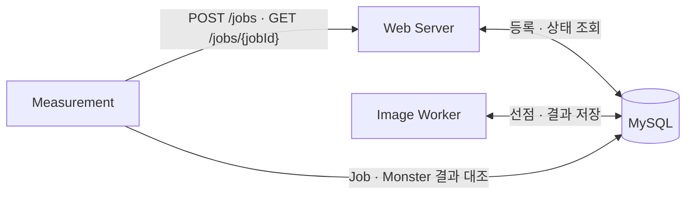

# ⑥ 이미지 생성 작업 300건의 측정 과정과 재현 방법

④에서는 이미지 생성 작업 300건을 모두 완료한 결과를, ⑤에서는 그 결과를 해석할 때의 제약을 설명했습니다. 이번에는 웹 서버와 Worker를 별도 JVM으로 실행한 정상 부하 측정에서, 접수한 작업과 최종 결과를 어떤 방법으로 대조했는지 정리하겠습니다.

2026년 10월 18일의 측정에는 HTTP로 요청을 보내고 MySQL에서 결과를 집계하는 별도 프로그램을 사용했습니다. 실행 조건과 요청별 기록을 함께 남겨, 같은 조건으로 다시 측정하거나 다른 조건의 결과와 비교할 수 있도록 했습니다.

## HTTP와 DB를 사용하는 별도의 측정 프로그램

측정 프로그램인 Measurement는 웹 서버와 Worker의 Java 클래스를 직접 호출하지 않습니다. `POST /jobs`로 작업을 등록하고, 응답에서 받은 Job ID로 `GET /jobs/{jobId}`를 호출해 종결 여부를 확인합니다. DB에서는 해당 Job과 연결된 `Monster`의 결과를 조회합니다.



세 역할을 각각 별도 JVM으로 실행하고, HTTP API와 MySQL 스키마를 통해 연결했습니다. 측정 흐름은 [MeasurementRunner](../06-final-300-job-measurement/src/main/java/com/kng0501/measurement/MeasurementRunner.java)에서 관리합니다.

매 실행에는 새로운 `runId`를 발급하고, 프롬프트에 `measurement-{runId}-{요청 번호}`를 넣었습니다. DB에서 이번 실행에 해당하는 작업을 조회하고, 실행별 결과 파일을 구분하기 위한 식별자입니다.

## 측정 전용 DB와 실행 조건 준비

재실행할 때는 Java 21과 MySQL을 준비하고, `technical-writing` 디렉터리에서 아래 명령을 실행합니다. 각 터미널의 DB 계정·비밀번호 환경변수는 [공통 MySQL 설정](../README.md#로컬-mysql-준비)을 따릅니다. 세 프로세스가 모두 같은 측정 전용 DB를 바라보도록 설정해야 합니다.

먼저 MySQL에 측정 전용 DB를 만들고 개선 구조의 스키마를 적용합니다.

```sql
CREATE DATABASE IF NOT EXISTS technical_writing_measurement
    CHARACTER SET utf8mb4 COLLATE utf8mb4_0900_ai_ci;
```

```bash
mysql --host=127.0.0.1 --user="$TECHNICAL_WRITING_DB_USERNAME" --password \
  technical_writing_measurement \
  < 04-reliability-hardening/src/main/resources/db/04/schema.sql
```

각 프로세스를 실행할 터미널에는 DB URL도 설정합니다.

```bash
export TECHNICAL_WRITING_DB_URL='jdbc:mysql://127.0.0.1:3306/technical_writing_measurement?connectionTimeZone=UTC&forceConnectionTimeZoneToSession=true'
```

Measurement는 시작할 때 DB 이름이 정확히 `technical_writing_measurement`인지 검사합니다. `queue_monster`나 `image_generation_job`에 데이터가 남아 있으면 실행을 중단합니다. 이전 실행의 데이터가 섞이지 않도록 빈 테이블을 확인하는 절차입니다. 검사 코드는 [MeasurementDatabase](../06-final-300-job-measurement/src/main/java/com/kng0501/measurement/MeasurementDatabase.java)에 있습니다.

## 세 프로세스를 나눠 실행

아래는 웹 서버의 기본 HTTP 포트인 8080을 사용하는 재실행 예시입니다. 10월 18일 측정에서 실제로 사용한 주소와 JVM 인자는 [실행 기록](../06-final-300-job-measurement/results/04a01500-aafe-44be-a619-9c4a1ad2b72b/README.md)에 별도로 남겼습니다.

첫 번째 터미널에서는 웹 서버를 실행합니다.

```bash
./gradlew run04WebServer
```

두 번째 터미널에서는 Worker가 최대 8개 작업을 동시에 실행하도록 설정합니다. 이미지 생성에는 작업당 5초 기다린 뒤 테스트용 결과를 반환하는 코드를 사용합니다.

```bash
./gradlew run04ImageWorker \
  --args='--db-queue.concurrency=8 --image-generator.delay=5s'
```

웹 서버와 Worker의 시작 로그를 확인한 뒤, 세 번째 터미널에서 Measurement를 실행합니다. 총 요청 수는 300건, 동시에 등록할 수 있는 HTTP 요청의 상한은 35개로 둡니다. 제한 시간은 10분, 관찰 간격은 1초입니다.

```bash
./gradlew run06Measurement \
  --args='--measurement.base-url=http://127.0.0.1:8080 --measurement.job-count=300 --measurement.request-concurrency=35 --measurement.timeout=10m --measurement.polling-interval=1s --measurement.expected-worker-concurrency=8 --measurement.expected-generator-delay=5s'
```

여기서 `measurement.expected-worker-concurrency`와 `measurement.expected-generator-delay`는 결과 파일에 기록할 비교 조건입니다. **Worker의 실제 동작은 Worker 실행 인자로 설정해야 합니다.** 측정 프로그램의 기록용 값도 그 설정에 맞춰 둡니다.

HTTP 등록 동시성 35는 실제 사용자 수나 초당 유입량을 뜻하지 않습니다. 이 프로그램은 최대 35개의 등록 요청을 동시에 실행하며, 일정한 초당 요청 수를 유지하도록 만들지는 않았습니다.

## 접수한 Job ID를 기준으로 최종 결과 대조

요청마다 HTTP 상태와 Job·Monster ID, 요청 시각과 응답 시간을 기록했습니다. HTTP 202를 받았더라도 유효한 두 식별자를 읽지 못하면 접수 실패로 분류합니다.

DB 집계에서는 정상 접수한 고유 Job ID를 기준으로 상태와 결과를 대조했습니다. `SUCCEEDED`는 성공, `FAILED`는 최종 실패로 집계합니다. 제한 시간에 `PENDING`이나 `RUNNING`으로 남아 있으면 미종결, 접수한 Job을 DB에서 찾지 못하면 누락입니다.

모의 생성 결과는 `image:{prompt}`이므로, Job에 저장된 프롬프트와 결과 문자열을 비교할 수 있습니다. 성공 상태인데 이미지가 없거나 기대한 문자열과 다르면 별도 항목으로 집계했습니다.

기본 검증의 통과 조건은 다음과 같이 정했습니다.

1. 300건 모두 HTTP 202로 접수되고, 고유 Job ID가 300개일 것.
2. 제한 시간 안에 모두 `SUCCEEDED`가 되고, 실패·미종결·누락·결과 오연결·이미지 없는 성공이 각각 0건일 것.
3. 전체 완료 시간을 기록하고, 정상 부하에서 재시도가 발생하면 원인을 확인할 것.

재시도 Job은 `attemptCount >= 2`인 작업으로 집계합니다. 이 횟수는 성공한 선점 횟수이므로, 실제 생성 호출 횟수와는 구분합니다. 집계 기준은 [MeasurementSummaryCalculator](../06-final-300-job-measurement/src/main/java/com/kng0501/measurement/MeasurementSummaryCalculator.java)에서 확인할 수 있습니다.

## 요청 응답 시간과 작업 대기·처리 시간 측정

HTTP 등록 응답 시간은 요청 전송을 준비하는 시점부터 응답을 받을 때까지 측정했습니다. Job 대기 시간은 `startedAt - createdAt`, 처리 시간은 `finishedAt - startedAt`으로 계산합니다. 백분위수는 밀리초 단위의 값을 정렬한 뒤 nearest-rank 방식으로 계산했습니다.

전체 완료 시간은 측정 시작부터 마지막 Job의 `finishedAt`까지입니다. 모든 작업의 상태를 확인하고 관찰을 끝내기까지 걸린 시간도 따로 기록했습니다. 작업이 끝난 시각과 측정 프로그램이 이를 확인한 시각을 구분하기 위해서입니다.

대기 작업 수는 요청을 등록하는 동안에도 별도 관찰 스레드가 조회합니다. 이번 설정에서는 1초 간격으로 `PENDING` 수를 확인하고, 관측한 최대값을 남겼습니다. 따라서 이 값은 관찰 사이의 순간 최대값까지 포착했다고 보장하지는 않습니다. 관찰 방식은 [QueueDepthMonitor](../06-final-300-job-measurement/src/main/java/com/kng0501/measurement/QueueDepthMonitor.java)에 구현했습니다.

## 결과 파일과 실행 환경을 함께 보존

관찰을 마치면 실행별 `runId` 디렉터리에 네 파일을 저장합니다.

| 파일 | 기록하는 내용 |
| --- | --- |
| `summary.json` | 접수·종결·누락·재시도 집계, 완료 시간과 백분위수 |
| `jobs.csv` | 요청별 ID, 상태·시도 횟수, 시각과 생성 결과 |
| `request-latency.csv` | HTTP 요청별 응답 시간과 실패 사유 |
| `environment.json` | 요청 수·동시 실행 설정, Java·OS·MySQL 버전 |

10월 18일 실행에는 실제 실행 인자와 소스 해시를 담은 `execution.json`, 각 프로세스의 로그, CSV·DB 대조 기록도 함께 남겼습니다. 프로그램이 생성하는 네 파일과 실행 후 추가한 검증 기록의 목록은 [해당 실행 디렉터리](../06-final-300-job-measurement/results/04a01500-aafe-44be-a619-9c4a1ad2b72b/README.md)에서 확인할 수 있습니다.

이 실행에서는 300건이 모두 성공했고 전체 완료 시간은 193.639초였습니다. CSV의 ID·상태·이미지와 백분위수 등을 다시 계산한 36개 대조 항목도 모두 일치했습니다. 상세 수치와 해석은 [④ 처리 결과](./04-results.md)를 참조합니다.

같은 측정을 다시 수행할 때도 실행 조건과 원본 파일을 함께 남기려고 합니다. 다음에는 Worker의 실행 상한과 생성 지연을 유지한 채 총 요청 수를 늘려, 대기 시간과 최대 `PENDING`, 전체 완료 시간이 어떻게 달라지는지 비교할 계획입니다. 300건을 넘는 추가 부하 측정은 아직 실행하지 않았으며, 확대 기준은 [06단계의 측정 범위](../06-final-300-job-measurement/README.md#측정-범위와-확대-기준)를 따릅니다.
