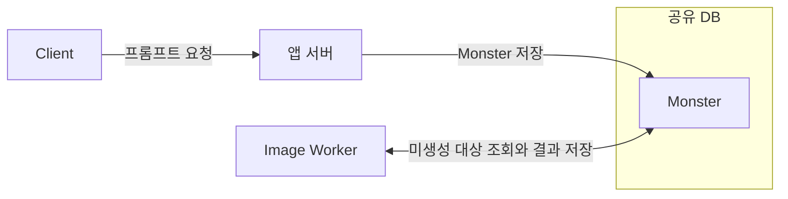
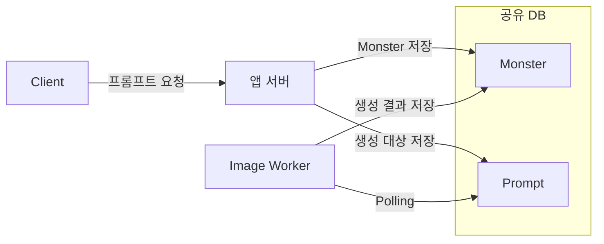
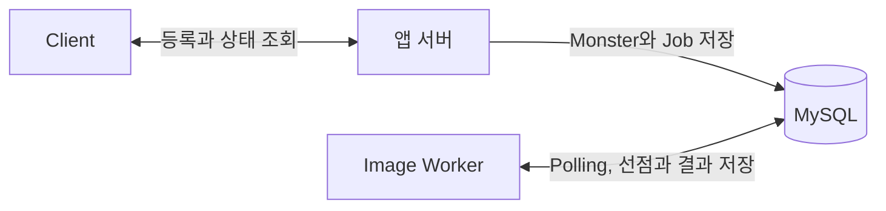
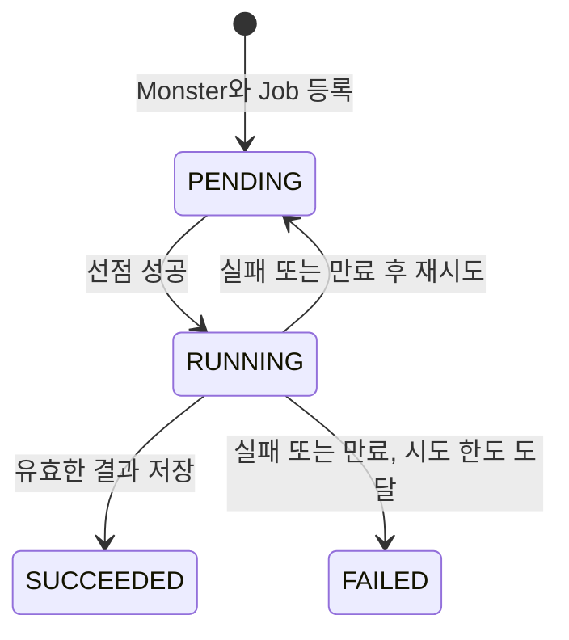
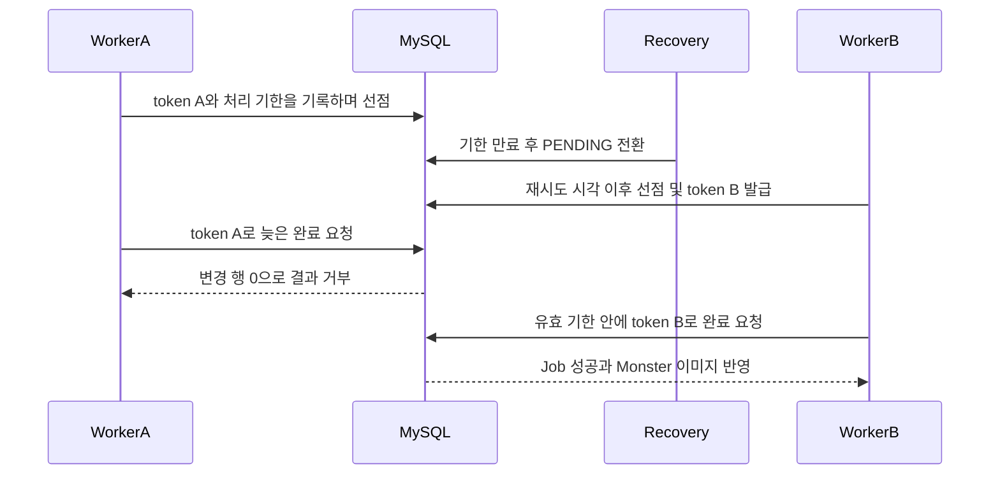

# DB Job Queue로 이미지 생성 작업을 보존하고 복구하기

작성자: 밀란

## 1. 이미지 생성 장애에서 시작한 신뢰성 점검

발표 날 제 서비스가 멈췄습니다.

시연 화면에는 `429 Too Many Requests` 오류가 나타났고 사용자들에게도 같은 응답이 돌아갔습니다. 어설프게 남겨둔 로그만으로는 무슨 일이 일어났는지 파악하기도 어려웠습니다.

당시에는 외부 작업의 완료와 애플리케이션 서버(이하 앱 서버)의 요청 응답을 충분히 분리하지 못했습니다. 일부 요청은 외부 워커의 작업이 끝날 때까지 동기적으로 기다리고 있었습니다. 외부 워커가 결함으로 중단된 뒤 응답을 기다리던 요청들이 타임아웃까지 서버 자원을 점유했을 가능성이 있었습니다.

지금 다시 만든다면 외부 워커가 멈춰도 앱 서버는 작업을 접수하고 응답할 수 있어야 한다고 생각했습니다. 접수한 작업은 남아 있어야 하고 다시 처리할 수 있어야 했습니다. 이 글에서는 그 기준으로 DB Job Queue를 설계하고 검증한 과정을 정리했습니다.

### 이미지가 없는 `Monster`를 조회하던 구조

커켓몬은 사용자가 입력한 프롬프트로 자신만의 몬스터 이미지를 만드는 서비스였습니다. 초기에는 앱 서버가 프롬프트를 가진 `Monster`를 DB에 저장했습니다. 별도의 이미지 생성 서버(이하 Worker)는 이미지가 없는 `Monster`를 일정한 간격으로 조회하고 모델을 호출해 생성한 이미지를 같은 DB에 기록했습니다. 이처럼 DB를 주기적으로 조회하는 방식을 Polling이라고 합니다.

| 테이블 | 역할 | Worker의 사용 방식 |
| --- | --- | --- |
| `Monster` | 프롬프트와 이미지 생성 결과를 보관합니다. | 이미지가 없는 `Monster`를 찾아 프롬프트를 읽고 이미지 생성 결과를 기록합니다. |



2025년 행사에서 35명의 사용자로부터 약 300건의 이미지 생성 요청이 들어왔습니다. 이를 처리하던 중 시스템이 사용자 요청에 응답하지 못하는 장애가 발생했습니다.

### `Prompt` 분리와 요청 제한

장애 이후에는 Worker가 이미지 생성 대상을 조회하는 테이블을 `Monster`에서 `Prompt`로 바꿨습니다. 프론트에서 연속 요청을 줄이는 디바운스와 계정당 하루 10개 생성 제한도 함께 적용했습니다. 최종 발표에서는 이전과 비슷한 규모의 요청을 처리할 수 있었습니다.

| 테이블 | 역할 | Worker의 사용 방식 |
| --- | --- | --- |
| `Monster` | 몬스터 도메인 데이터와 이미지 생성 결과를 보관합니다. | 생성 결과를 기록합니다. |
| `Prompt` | 이미지 생성 대상을 따로 보관합니다. | 생성 대상을 Polling으로 조회합니다. |



위 표와 그림은 과거 기록을 바탕으로 각 테이블의 역할과 데이터 흐름을 요약한 개념도입니다.

### 확인하지 못한 변경 효과와 작업별 처리 결과

당시에는 이 대응이 서비스 안정화에 도움이 됐다고 판단했습니다. 다만 여러 변경을 함께 적용했으므로 각각의 효과를 구분할 수 없었습니다. 작업별 접수, 완료와 실패 여부를 측정한 기록도 없었습니다. 작업 유실이나 중복 실행 여부와 시스템이 요청에 응답하지 못한 원인은 확인이 필요합니다. 따라서 비슷한 규모를 다시 처리했다는 사실만으로 개별 작업이 모두 올바르게 처리됐다고 판단할 수는 없습니다.

### 실험에서 검증할 신뢰성 문제 5가지

살펴볼 대상은 앱 서버의 요청 등록부터 Worker의 작업 실행과 결과 반영까지입니다. 프론트 디바운스와 계정당 하루 10개 생성 제한은 당시 대응의 배경으로 소개하며 프론트 구현 및 생성 정책의 설계와 검증은 글의 범위에서 제외하겠습니다.

실험에서는 과거 구조를 참고해 Java, Spring Boot, JPA로 새로 만든 ‘최소 구조’를 기준으로 삼습니다. 앱 서버와 Worker는 각각 별도 JVM 프로세스로 실행하도록 구성하고 MySQL만 공유합니다. 이미지 생성은 5초 지연을 주는 모의 생성기(Generator)로 대체합니다.

이 글에서는 이미지 생성 작업 한 건을 Job이라고 하겠습니다. 선점은 Worker가 Job을 처리할 권한을 얻는 과정입니다. 이번 실험에서는 요청 등록부터 결과 반영까지 발생할 수 있는 다음 다섯 가지 신뢰성 문제를 검증합니다.

1. **등록 비원자성:** `Monster` 저장 후 Job 등록이 실패하면 생성 작업이 없는 `Monster`가 남을 수 있습니다.
2. **중복 선점:** 여러 Worker가 같은 Job을 조회하고 모두 실행하면 이미지 생성이 중복될 수 있습니다.
3. **작업 유실:** 처리 전에 작업 행을 삭제하고 Worker가 멈춘다면 복구할 작업 행이 DB에 남지 않습니다.
4. **결과 오연결:** Job ID를 `Monster` ID처럼 사용하면 생성 결과가 다른 `Monster`에 저장될 수 있습니다.
5. **Scheduler 중단:** 한 작업의 예외로 주기적인 작업 조회가 중단되면 이후 Job도 처리되지 않을 수 있습니다.

과거 운영에서 실제로 확인한 문제는 스케줄러가 멈추는 것이었습니다. 이번에는 이 문제를 출발점으로 당시와 유사한 구조에서 추가로 발생할 수 있는 신뢰성 문제도 함께 살펴봅니다. 최소 구조에서 각 실패를 재현한 뒤 작업 상태 관리와 원자적 선점, 타임아웃 복구와 재시도, 오래된 결과 거부 규칙을 추가한 개선 구조에서 같은 조건을 검증합니다.

## 2. DB Job Queue를 선택한 이유

이번 실험에서는 이미지 생성 Job을 DB에 저장하고 Worker가 Polling으로 가져가는 DB Job Queue를 선택했습니다. 작업을 보존하면서 `Monster`와 Job을 같은 트랜잭션으로 등록할 수 있기 때문입니다.

앱 서버는 이미지 생성이 끝날 때까지 기다리지 않고 작업을 잘 등록했다는 응답을 먼저 반환하도록 했습니다. 응답한 뒤에도 등록한 작업을 다시 찾을 수 있어야 하고 `Monster`와 Job 중 하나만 저장되는 상황도 막아야 했습니다.

당시 Worker는 연구실의 로컬 컴퓨터에서 실행했고 앱 서버에서 직접 호출할 수 없었습니다. 추가 인프라도 학습에 드는 시간과 운영 부담 때문에 도입하기 어려웠습니다. 당시 제약을 유지해 이번에도 앱 서버와 Worker가 MySQL만 공유하도록 했습니다.

이 조건에서 작업 보존과 등록 원자성 및 운영 비용을 기준으로 네 가지 방식을 비교했습니다.

| 방식 | 이번 조건에서 고려한 점 | 판단 |
| --- | --- | --- |
| 별도 작업 저장소 없는 `@Async` | 실행 요청을 메모리에만 두면 프로세스 종료 후 복구할 수 없어 별도 저장과 복구 규칙이 필요합니다. | 거부 |
| 앱 서버 → Worker 직접 HTTP 호출 | Worker를 직접 호출할 수 없고 DB 저장과 원격 접수 사이의 실패 처리도 필요합니다. | 거부 |
| DB Job Queue | 기존 MySQL에 작업을 보존하고 `Monster`와 Job을 같은 트랜잭션으로 등록할 수 있습니다. | 채택 |
| 메시지 브로커 | 작업 전달을 맡길 수 있지만 DB 저장과 메시지 발행의 연계 및 추가 인프라 운영이 필요합니다. | 비범위 |

이 비교는 작업을 어디에 남기고 등록 실패를 어떻게 처리할지에 대한 판단입니다. 방식별 처리량을 비교한 결과는 아닙니다.

DB Job Queue를 사용하더라도 Polling 조회 비용과 선점 및 복구 규칙은 직접 관리해야 합니다. 여러 Worker 중 누가 작업을 실행할지와 실행이 멈춘 작업을 언제 복구할지까지 정해야 했죠.

## 3. DB Job Queue에 추가한 신뢰성 규칙

2장에서 선택한 DB Job Queue에 등록 트랜잭션, 작업 상태, 원자적 선점, 타임아웃 복구와 결과 반영 규칙을 추가했습니다. 앱 서버와 Worker가 MySQL만 공유하는 구조는 유지하고 요청 등록부터 결과 저장까지 각 작업을 추적할 수 있도록 했습니다.

이번 구현은 1장에서 설명한 과거 구조를 참고해 재구성한 최소 구조를 기준으로 삼았습니다. 최소 구조에서 어떤 문제가 생길 수 있었는지와 이를 다루기 위해 추가한 규칙을 차례로 설명하겠습니다.

### 별도 JVM으로 나눈 앱 서버와 Worker

앱 서버와 Worker를 각각 별도의 JVM으로 실행하도록 애플리케이션을 나눴습니다. 앱 서버는 요청 등록과 상태 조회를 담당하고 Worker는 DB에서 작업을 찾아 이미지를 생성하고 결과를 기록하도록 했습니다.

앱 서버는 `POST /jobs`로 받은 프롬프트를 `Monster`와 Job으로 저장합니다. 등록 트랜잭션이 커밋되면 `202 Accepted`와 두 식별자(두 식별자가 뭐지)를 반환합니다. 이 응답은 작업 접수가 완료됐다는 의미이며 이후 상태와 생성 결과는 `GET /jobs/{jobId}`로 조회합니다.

Worker는 HTTP 서버를 열지 않고 MySQL에서 실행할 Job을 Polling으로 조회합니다. 이미지 생성에는 5초 뒤 `image:{prompt}`를 반환하는 모의 생성기(Generator)를 사용했습니다. 생성 지연을 제어하면서 작업 처리 규칙을 살펴보기 위한 구성입니다.



`Monster`에는 몬스터 정보와 생성 결과를 보관했습니다. Job에는 작업 상태와 실행 정보를 보관했습니다.

| 테이블 | 역할 | 핵심 데이터 |
| --- | --- | --- |
| `queue_monster` | 몬스터 정보와 생성 결과 보관 | `monster_id`, `prompt`, `image` |
| `image_generation_job` | 생성 작업의 상태와 실행 권한 관리 | `job_id`, `monster_id`, `status`, `attempt_count`, `next_attempt_at`, `deadline_at`, `claim_token` |

표와 그림은 이번 재구성의 테이블과 처리 흐름을 요약한 것입니다.

### Monster와 Job을 함께 저장하는 등록 트랜잭션

최소 구조에서는 `Monster` 저장과 생성 요청 저장을 하나의 트랜잭션으로 묶지 않았습니다. `Monster`를 저장한 뒤 생성 요청 저장에 실패하면 생성할 작업이 없는 `Monster`가 남을 수 있었습니다.

개선 구조에서는 JobRegistrationService.request()에 트랜잭션 경계를 두고 두 데이터를 함께 저장했습니다. Job 저장이 실패하면 앞서 저장한 `Monster`도 함께 롤백되도록 했습니다.

등록할 때는 Job이 결과 대상인 `Monster`를 명시적으로 참조하도록 했습니다. 이후 결과를 저장할 때도 이 연결에 기록된 `monster_id`를 사용합니다.

### 작업 행을 보존하는 네 가지 상태

최소 구조에서 Worker는 조회한 요청 행을 삭제한 뒤 Generator를 호출합니다. 삭제 이후 생성 중에 예외가 발생하면 다시 처리할 요청 행을 찾을 수 없습니다.

개선 구조에서는 Job 행을 보존하고 상태로 처리 과정을 나타냈습니다. `PENDING`은 대기 중인 작업, `RUNNING`은 Worker가 선점한 작업입니다. 결과 저장에 성공하면 `SUCCEEDED`, 실패나 기한 만료 후 더 시도할 수 없으면 `FAILED`로 종결합니다.



성공하거나 최종 실패한 Job도 남겨둡니다. 이를 통해 작업의 최종 상태와 시도 횟수, 실패 사유를 조회할 수 있도록 했습니다.

### 조건부 UPDATE로 실행 권한 획득

여러 Worker가 같은 대기 작업을 조회하는 것은 가능합니다. 그래서 후보 조회와 선점을 나누고 해당 Job을 `PENDING`에서 `RUNNING`으로 바꾸는 데 성공한 Worker만 Generator를 호출하도록 했습니다.

아래는 선점 쿼리에 사용한 JPQL입니다.

```sql
update ImageGenerationJobEntity job
   set job.status = :running,
       job.claimToken = :token,
       job.deadlineAt = :deadline,
       job.attemptCount = job.attemptCount + 1,
       job.startedAt = :now,
       job.finishedAt = null
 where job.id = :jobId
   and job.status = :pending
   and job.nextAttemptAt <= :now
   and job.attemptCount < :maxAttempts
```

대기 상태이면서 다음 실행 가능 시각이 됐고 최대 시도 횟수에 도달하지 않은 Job만 선점할 수 있습니다. UPDATE가 변경한 행이 1개이면 실행 권한을 얻고 0개이면 실행하지 않습니다.

선점할 때마다 새로운 실행 식별자인 `claimToken`과 처리 기한인 `deadlineAt`을 함께 기록합니다. 시도 횟수도 이때 증가합니다. 이후 완료와 실패 요청이 어느 실행에서 왔는지 구분하기 위한 정보입니다.

조건부 UPDATE에도 InnoDB의 레코드 잠금이 사용됩니다. 선점 트랜잭션은 이미지 생성 전에 커밋하고 Generator 호출은 트랜잭션 밖에서 실행하도록 했습니다. 이미지 생성 시간 동안 선점 트랜잭션과 잠금을 유지하지 않도록 하기 위해서입니다.

JPA의 일괄 UPDATE 뒤에 이전 엔티티 상태를 재사용하지 않도록 `@Modifying`에 `flushAutomatically = true`, `clearAutomatically = true`를 설정했습니다. 선점 후에는 Job 데이터를 다시 조회해 실행에 사용할 스냅샷으로 변환합니다.

### 처리 기한 만료 후 복구와 재시도

Worker가 선점한 뒤 완료나 실패를 기록하지 못하면 Job은 `RUNNING`에 남습니다. 이 상태를 다시 처리할 수 있도록 별도의 복구 작업이 처리 기한이 지난 Job을 주기적으로 조회하게 했습니다.

재시도 여유가 있으면 Job을 `PENDING`으로 돌리고 재시도 간격을 더한 다음 실행 가능 시각을 `nextAttemptAt`에 기록합니다. 최대 시도 횟수를 채운 상태에서 실패하거나 기한이 만료되면 `FAILED`로 종결합니다.

복구 대상을 조회한 뒤에도 다른 처리가 진행될 수 있습니다. 그래서 복구 전환의 UPDATE에서도 상태, 현재 token, 시도 횟수와 기한 만료 조건을 다시 확인합니다. 조회 당시의 정보로 이미 완료됐거나 재선점된 작업을 바꾸지 않도록 했습니다.

### claimToken으로 오래된 결과 거부

기한이 만료된 Job을 다시 선점하면 새로운 `claimToken`을 발급합니다. 이때 이전 Worker의 이미지 생성이 뒤늦게 끝나더라도 이전 token으로 현재 작업의 결과를 바꿀 수 없어야 합니다.



완료 UPDATE는 `RUNNING` 상태, 현재 `claimToken`, `deadlineAt > now` 조건을 함께 검사합니다. 변경한 행이 0개이면 `Monster`의 이미지도 갱신하지 않습니다. 실패 전환에도 현재 token과 시도 횟수, 유효 기한 조건을 적용했습니다.

완료 처리에서는 Job의 성공 전환과 `Monster`의 이미지 갱신을 하나의 트랜잭션으로 묶었습니다. 결과 대상은 Job의 `monster_id`로 찾고 이미지 갱신이 실패하면 성공 전환도 함께 롤백합니다.

**오래된 결과를 거부하는 타이밍은 DB에 결과가 반영될 때 입니다.** 처리 기한이 지났다고 기존 Generator 호출이 자동으로 중단되지는 않습니다. 이전 실행과 재시도가 겹치면 이미지 생성 자체는 중복될 수 있습니다는 한계가 있습니다.

### 작업 실패를 격리하는 예외 처리

Worker는 이미지 생성이나 완료 처리에서 예외가 발생하면 해당 Job의 실패 전환을 시도합니다. 실패 기록마저 저장하지 못하면 오류를 로그에 남기고 DB에 보존된 `RUNNING` 상태와 처리 기한을 통해 만료 복구가 다시 접근하도록 했습니다.

Polling 단계에서는 작업 조회와 만료 복구를 실행하는 스케줄러 경계에서 `RuntimeException`을 기록하도록 했습니다. 한 번의 조회나 복구에서 발생한 예외를 처리하고 다음 주기에도 실행할 수 있도록 구성했습니다.

이미지 생성용 실행 풀과 작업 조회 및 복구용 스케줄러도 분리했습니다. 긴 이미지 생성이 제어용 스케줄러의 스레드를 점유하지 않도록 하고 JobScheduler가 실행 여유를 확보한 뒤 Job을 선점하도록 했습니다.

## 4. 실패 복구와 300건 처리 검증

3장에서 추가한 규칙은 실패가 생겨도 접수한 작업을 추적하고 처리를 이어가기 위한 것입니다. 그래서 검증도 작업이 실패한 뒤의 상태와 다음 작업의 처리를 중심으로 진행했습니다.

### 한 작업이 실패해도 다음 작업은 처리돼야 합니다

과거에 겪었던 스케줄러 중단부터 확인했습니다. 모의 Generator가 첫 작업에서 예외를 던지게 한 뒤 후속 작업을 등록했습니다.

기본 Polling 구현에서는 예외가 스케줄러 밖으로 전파돼 후속 작업이 완료되지 않았습니다. Job Queue 구현에서는 실패를 해당 Job에 기록하고 다음 조회를 계속해 후속 작업을 완료했습니다. 한 작업의 실패가 이후 작업까지 멈추게 하지 않는지 확인한 것이죠.

### 무응답 작업 복구와 오래된 결과 거부

Worker가 Job을 선점한 뒤 완료나 실패를 기록하지 않는 상황도 만들었습니다. 테스트에서 처리 기한을 넘긴 뒤 복구를 실행하자 Job은 다시 `PENDING`으로 돌아갔습니다. 이후 새로운 `claimToken`으로 재선점해 작업을 완료할 수 있었습니다.

이전 token으로 보낸 늦은 완료 요청은 거부됐고 새 token으로 완료한 이미지만 저장됐습니다. 작업을 다시 실행할 수 있게 하면서 이전 실행의 결과가 뒤늦게 반영되는 상황도 막은 것입니다. 이 테스트는 DB에 남은 무응답 상태의 복구를 검증하며 실제 Worker 프로세스의 종료와 재시작은 아직 확인하지 않았습니다.

등록 실패 시 롤백과 선점 경쟁 및 결과 연결을 포함한 다섯 가지 회귀 검증이 통과했습니다. 추가로 이미지 저장을 실패시켜 Job의 성공 전환도 함께 롤백되는지 확인했습니다. 결과를 저장하지 못한 작업이 성공으로 남지 않고 다시 시도할 수 있는지 확인한 것입니다.

### 300건 모두 성공한 정상 부하 검증

개별 실패 상황을 검증한 뒤에는 HTTP로 접수한 작업이 실제 결과까지 이어지는지 살펴봤습니다. 앱 서버와 Worker 및 측정 프로그램을 각각 별도 JVM으로 실행했습니다. Worker는 프로세스 하나에서 최대 8개 작업을 동시에 실행하고 이미지 생성 대신 작업당 5초를 기다리도록 했습니다. 등록 요청은 최대 35개를 동시에 보내도록 설정해 총 300건을 전송했습니다.

접수 응답에서 받은 Job ID를 기준으로 DB의 최종 상태와 `Monster` 이미지를 대조했습니다. 300건은 모두 성공했고 접수 시작부터 마지막 작업 완료까지 193.639초가 걸렸습니다. 접수한 작업의 누락이나 결과 오연결은 발견되지 않았고 각 프롬프트에 맞는 결과가 저장된 것도 확인했습니다. 작업을 접수한 뒤 최종 결과까지 추적할 수 있는지 확인한 것입니다.

### 빠른 접수 응답이 작업 완료를 뜻하지는 않습니다

300건을 짧은 시간에 접수해도 한 번에 실행하는 작업은 최대 8개입니다. 나머지는 Job 테이블에서 차례를 기다렸죠.

등록 요청의 95%는 160ms 안에 접수 응답을 받았습니다. 그러나 생성 시작 전 대기 시간의 95번째 백분위수(p95)는 178.087초였습니다. 접수는 빨리 끝나도 일부 작업은 이미지를 만들기 시작하기까지 약 3분을 기다렸다는 뜻입니다.

따라서 운영에서는 접수 응답 시간과 사용자가 실제 결과를 기다리는 시간을 함께 봐야 합니다. 작업을 안전하게 남기는 규칙에 더해 처리 속도와 대기 허용 시간에 맞춰 동시 처리 상한과 접수 제한을 정해야 합니다.

## 5. 운영에 적용하기 전에 확인할 제약

이번 실험에서는 앱 서버와 Worker가 MySQL만 공유하는 구조를 유지하면서 작업 보존, 선점, 복구와 결과 반영 규칙을 검증했습니다. 운영에 적용하려면 이 규칙의 보장 범위와 함께 DB 조회 비용, 실제 이미지 생성 시간, 처리할 수 있는 작업량을 확인해야 합니다.

4장에서 확인한 300건의 정상 완료를 기준으로 현재 구현에 남아 있는 제약과 다음에 살펴볼 지표를 정리하겠습니다.

### Polling 조회와 작업 보존의 비용

Worker는 실행 여유가 있을 때 DB에서 처리할 후보를 찾고 복구 작업은 처리 기한이 지난 Job을 주기적으로 조회합니다. 두 조회의 기본 간격은 각각 100ms입니다. 처리할 작업이 없어도 조회가 발생하며 Worker 프로세스를 추가하면 각 프로세스가 같은 DB를 조회합니다.

Polling 간격을 줄이면 새 작업을 더 자주 확인할 수 있지만 조회 횟수가 늘어납니다. Worker를 늘릴 때도 같은 후보를 두고 경쟁하는 비용을 함께 봐야 합니다.

이번 스키마에는 작업 상태별로 대기 작업과 만료 작업을 찾기 위한 인덱스를 뒀습니다. 완료되거나 실패한 Job도 검증을 위해 보존하므로 데이터는 계속 쌓입니다. 운영에서는 조회 횟수와 실행 시간, 누적 행 수를 관찰하고 보존 기간과 정리 방식을 따로 정해야 합니다.

### claimToken의 보장은 DB 결과 반영까지

`claimToken`은 선점할 때마다 새로 발급하는 실행 식별자입니다. 같은 Job을 다시 선점하면 이전 token의 완료 요청을 거부해 늦게 도착한 결과가 현재 결과를 덮어쓰지 않도록 했습니다.

다만 처리 기한이 만료돼도 기존 Generator 호출이 자동으로 끝나지는 않습니다. 이전 실행이 계속되는 동안 다른 Worker가 재선점하면 두 실행의 이미지 생성 호출이 겹칠 수 있습니다. **현재 규칙이 제한하는 범위는 같은 Job의 DB 결과 반영입니다.** 외부 이미지 생성 호출이 정확히 한 번 발생한다는 보장은 하지 않습니다.

### 처리 기한과 재시도 설정의 한계

처리 기한이 실제 생성 시간보다 짧으면 정상적으로 진행 중인 작업도 만료될 수 있습니다. 이를 재시도하면 이미지 생성 호출과 비용이 추가로 발생할 수 있죠. 반대로 기한을 길게 잡으면 응답하지 않는 작업을 복구하기까지 더 오래 기다립니다.

이번 실험에서는 작업당 5초를 기다리는 모의 생성기에 처리 기한 30초를 적용했습니다. 재시도 간격은 1초, 최대 선점 횟수는 최초 선점을 포함해 3회로 뒀습니다. 이 값은 실험 조건으로 정했으며 운영에 적절한지는 실제 생성 시간 분포와 실패 유형을 보고 확인해야 합니다.

현재는 작업이 진행 중임을 주기적으로 알리고 처리 기한을 연장하는 기능이 없습니다. 실패가 반복될수록 재시도 간격을 늘리거나 재시도 시점을 무작위로 분산하는 기능도 넣지 않았습니다. 여러 작업이 비슷한 시점에 실패하면 재시도가 몰릴 수 있으므로 외부 생성 서버에 가해지는 부하도 확인해야 합니다. [AWS의 타임아웃과 재시도, 백오프와 지터 설명](https://aws.amazon.com/builders-library/timeouts-retries-and-backoff-with-jitter/)

DB 상태를 복구하는 것과 실행 자원이 반환되는 것도 구분해야 합니다. JobScheduler는 실행 작업이 끝날 때 동시 실행 자리를 반환합니다. 따라서 생성 호출이 응답하지 않고 계속 남아 있으면 Job을 `PENDING`으로 돌려도 그 호출이 차지한 실행 자리는 반환되지 않습니다. 실제 생성 API를 연결할 때는 호출의 타임아웃과 취소 동작이 실행 자원을 반환하는지도 별도 확인이 필요합니다.

### Worker별 실행 상한과 대기열 증가

동시 처리 상한은 Worker 프로세스 하나가 한 번에 실행할 수 있는 작업 수입니다. 예를 들어 각 Worker가 최대 8개씩 실행하도록 설정하고 프로세스 두 개를 띄우면 전체에서는 최대 16개가 실행될 수 있습니다. 현재 구현에는 여러 프로세스를 합친 전역 상한이 없습니다.

4장의 300건 측정에서는 Worker 프로세스 하나가 최대 8개를 동시에 실행하고 각 작업은 테스트 코드에서 5초를 기다리도록 했습니다. 항상 8개가 실행되고 모든 작업이 정확히 5초 걸린다고 가정하면 생성 단계의 평균 처리율은 `8 ÷ 5 = 1.6건/초`로 계산할 수 있습니다. (이 값에는 DB 처리와 스케줄링 시간이 들어 있지 않습니다.)

이보다 빠르게 작업이 계속 들어오면 대기 작업이 쌓입니다. 현재 등록 경로에는 대기 중인 Job 수를 기준으로 접수를 제한하는 로직도 없습니다. 작업을 DB에 남기면서도 사용자가 이미지 결과를 받기까지의 시간은 계속 길어질 수 있습니다.

### DB Job Queue를 다시 검토할 시점

이번 실험에서는 도메인 데이터와 Job을 같은 트랜잭션으로 등록할 수 있는 DB Job Queue를 유지했습니다. 앞으로는 다음 지표를 관찰하면서 현재 구현을 조정할지 작업 전달 방식을 바꿀지 판단하려고 합니다. 표는 추가 검증의 기준이며 모든 현상이 이번 실행에서 관측됐다는 뜻은 아닙니다.

| 관측할 현상 | 다시 확인할 항목 |
| --- | --- |
| 작업이 적어도 DB 조회량과 조회 시간이 큼 | Polling과 복구 간격, 인덱스, 누적 Job 수와 Worker 수 |
| 대기 시간과 PENDING 및 미종결 작업이 계속 증가 | 요청 유입, 실제 생성 시간, 동시 처리 상한과 접수 제한 |
| 정상 작업의 만료와 재시도가 잦음 | 생성 시간 분포, 처리 기한, 실패 유형과 재시도 간격 |
| 같은 후보의 선점 경쟁이 잦음 | 후보 조회 순서, 선점 성공률과 작업 분배 방식 |
| 작업 전달을 업무 DB에서 분리할 필요가 생김 | 메시지 브로커의 전달과 재전송 규칙과 추가 운영 비용 |

메시지 브로커를 선택할 때도 이미지 생성의 처리 용량과 중복 전달에 대응할 규칙은 함께 설계해야 합니다. 예를 들어 RabbitMQ의 신뢰성 문서도 장애 뒤 재전송이나 재전달이 발생할 수 있으므로 소비자의 중복 제거 또는 멱등 처리가 필요하다고 설명합니다. [RabbitMQ의 신뢰성 가이드](https://www.rabbitmq.com/docs/reliability)

이후 Worker의 실행 상한과 모의 생성 지연을 유지한 채 요청 1,500건을 180초 구간에 투입해 모두 완료했습니다. 작업 대기의 p95는 734.125초였고 관측한 최대 `PENDING`은 1,212건이었습니다. 이 대기 작업 수는 1초 간격으로 관찰한 값입니다. 작업을 보존하고 모두 완료하더라도 사용자가 기다리는 시간은 길어질 수 있는 것이죠. 운영에서는 실제 생성 시간을 바탕으로 사용자가 기다릴 수 있는 시간을 정하고 접수량을 제한할지 검토해야 합니다.
